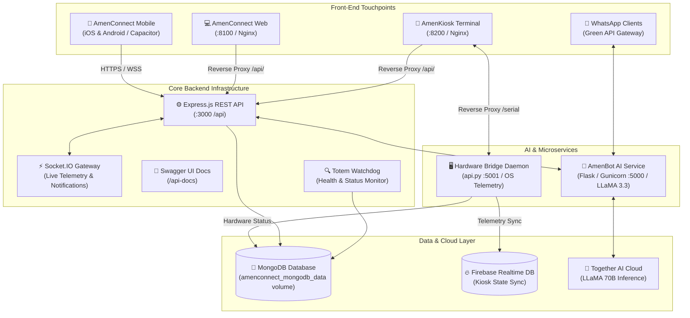

# AmenConnect 🏦💳

[](docker-compose.yml)
[](docker-compose.yml)
[](https://github.com/nexusMAKO1/amenconnect/actions/workflows/ci.yml)
[](https://github.com/nexusMAKO1/amenconnect/actions/workflows/codeql.yml)
[](https://react.dev/)
[](https://ionicframework.com/)
[](https://capacitorjs.com/)
[](https://nodejs.org/)
[](https://expressjs.com/)
[](https://www.mongodb.com/)
[](https://www.python.org/)
[](LICENSE)

> **Next-Generation Omnichannel Digital Banking & Interactive Self-Service Totem Terminal Ecosystem.**

AmenConnect is a unified, full-stack banking platform designed for modern financial institutions. It bridges everyday digital banking (Web, iOS, and Android) with in-branch physical self-service kiosks (Totems), backed by secure REST APIs, real-time WebSocket telemetry, and an AI-driven conversational assistant.

---

## 🐳 Quick Start with Docker (Recommended)

Run the entire ecosystem with zero manual local configuration:

```bash
# 1. Clone the repository
git clone https://github.com/nexusMAKO1/amenconnect.git
cd amenconnect

# 2. Copy the environment configuration
cp .env.example .env

# 3. Build and launch all 6 services in detached mode
docker compose up --build -d
```

### Access Services in Your Browser:
- 📱 **AmenConnect Web Client**: [http://localhost:8100](http://localhost:8100)
- 🏧 **AmenKiosk Totem Terminal**: [http://localhost:8200](http://localhost:8200)
- ⚙️ **Backend REST API**: [http://localhost:3000](http://localhost:3000)
- 📖 **Swagger OpenAPI Documentation**: [http://localhost:3000/api-docs](http://localhost:3000/api-docs)
- 🤖 **AmenBot Python Service**: [http://localhost:5050](http://localhost:5050)
- 🖥️ **Hardware Telemetry Daemon**: [http://localhost:5001](http://localhost:5001)
- 🍃 **MongoDB Database**: `localhost:27018` (internal: `mongodb:27017`)

---

## 📑 Table of Contents

- [Quick Start with Docker](#-quick-start-with-docker-recommended)
- [Docker Architecture & Operations Guide](#-docker-architecture--operations-guide)
- [Architectural Overview](#-architectural-overview)
- [Ecosystem Modules](#-ecosystem-modules)
  - [1. AmenConnect (Web & Mobile Banking)](#1-amenconnect-web--mobile-banking)
  - [2. AmenKiosk (Self-Service Terminal)](#2-amenkiosk-self-service-terminal)
  - [3. Backend (API & Realtime Gateway)](#3-backend-api--realtime-gateway)
  - [4. AmenBot (Conversational AI & WhatsApp)](#4-amenbot-conversational-ai--whatsapp)
  - [5. Hardware Daemon (`api.py`)](#5-hardware-daemon-apipy)
- [Technology Stack](#-technology-stack)
- [Local Manual Development Setup](#-local-manual-development-setup)
- [Environment Configuration](#-environment-configuration)
- [API Documentation & Swagger](#-api-documentation--swagger)
- [Project Directory Structure](#-project-directory-structure)
- [Contributing](#-contributing)
- [Security Policy](#-security-policy)
- [License](#-license)

---

## 🐳 Docker Architecture & Operations Guide

### Containerized Services Overview

| Container Service | Base Image | Internal Port | Host Port | Purpose |
| :--- | :--- | :--- | :--- | :--- |
| `amenconnect-mongodb` | `mongo:7.0` | `27017` | `27018` | Persistent NoSQL database |
| `amenconnect-backend` | `node:20-alpine` | `3000` | `3000` | Express REST API & Socket.IO server |
| `amenconnect-bot` | `python:3.11-slim` | `5000` | `5050` | LLaMA 3.3 banking assistant & WhatsApp bot |
| `amenconnect-hardware-daemon` | `python:3.11-slim` | `5001` | `5001` | Totem hardware serial & telemetry bridge |
| `amenconnect-client` | `nginx:alpine` (Multi-stage) | `80` | `8100` | Customer Web & Mobile banking interface |
| `amenconnect-kiosk` | `nginx:alpine` (Multi-stage) | `80` | `8200` | Interactive self-service kiosk interface |

### Docker Operations Reference

```bash
# Build and start all services in the background
docker compose up --build -d

# Check live health status of all containers
docker compose ps

# View aggregate streaming logs from all services
docker compose logs -f

# View logs for a specific service
docker compose logs -f backend
docker compose logs -f bot
docker compose logs -f amenconnect
docker compose logs -f amenkiosk

# Restart the entire stack
docker compose restart

# Restart a specific service
docker compose restart backend

# Stop all services (preserves persistent database volumes)
docker compose down

# Stop all services AND reset database volumes
docker compose down -v

# Rebuild a specific image after making code changes
docker compose build backend
docker compose up -d backend
```

---

## 🏛 Architectural Overview



---

## 🚀 Ecosystem Modules

### 1. AmenConnect (Web & Mobile Banking)
Located in [`AmenConnect/`](AmenConnect)
- **Universal Multi-Platform**: Built on Ionic React with Capacitor 7 for seamless deployment to iOS, Android, and modern desktop/mobile browsers.
- **Financial Accounts & Cards**: Real-time balance queries, card activation/blocking, PIN management, and monthly limits.
- **Transfers & Payments**:
  - Instant one-to-one wire transfers (`Virement`).
  - Scheduled automated recurring transfers (`Virement Programmé`).
  - Bulk transfers to multiple beneficiaries (`Virement Groupé`).
- **Interactive Budgeting & Analytics**: Visual expense categorization and budget breakdowns powered by `Recharts` and `Chart.js`.
- **Branch & ATM Finder**: Interactive geolocation-aware branch locator powered by `Leaflet` and cluster markers.
- **Advisor Video Conferencing**: In-app video appointments and remote support requests with bank advisors.
- **Robust Security**: Multi-factor authentication (2FA SMS/Email OTP), biometric unlock via Capacitor Device, and QR-code web session login.

### 2. AmenKiosk (Self-Service Terminal)
Located in [`AmenKiosk/`](AmenKiosk)
- **Touch-First Terminal Interface**: Tailored for full-screen touch totems with customized responsive layouts.
- **Virtual On-Screen Keyboard**: Integrated virtual touch keypad (`react-simple-keyboard`) with high-contrast accessibility.
- **Digital Signature Pad**: Secure client signature capture on-screen (`react-signature-canvas`) for account opening and forms.
- **Dynamic PDF Receipt Generation**: Instant banking receipt, statement, and ticket generation using `jsPDF` and `jspdf-autotable`.
- **QR Quick-Pairing**: Instant QR authentication allowing mobile customers to transfer their session to the terminal.
- **Live Theme Customizer**: Real-time styling engine allowing dynamic branding, banking color palettes, and seasonal kiosk themes.

### 3. Backend (API & Realtime Gateway)
Located in [`Backend/`](Backend)
- **RESTful Banking API**: Over 30 modular route controllers covering authentication, credit simulations, payments, card operations, audit logs, and kiosk management.
- **Real-Time Communication**: `Socket.io` connection server handling instant notifications, administrative alerts, and kiosk heartbeat synchronization.
- **Totem Watchdog (`monitorTotems.js`)**: Background polling service monitoring connected kiosk terminals, hardware status, and alerting admins when a terminal goes offline.
- **Enterprise Security**: Rate limiting (`express-rate-limit`), HTTP header protection (`helmet`), CORS enforcement, and audit trail logging with `winston`.
- **Automated Documentation**: Interactive Swagger OpenAPI 3.0 documentation available directly at `/api-docs`.

### 4. AmenBot (Conversational AI & WhatsApp)
Located in [`bot/`](bot)
- **Banking LLM Engine**: Powered by Meta-Llama 3.3 70B Instruct Turbo via Together AI.
- **Multi-Turn Context Awareness**: Understands banking queries, explains loan calculations, retrieves account details, and answers customer questions in French, Arabic, and English.
- **WhatsApp Gateway**: Seamless bi-directional messaging with customers via Green API webhook and polling integration.

### 5. Hardware Daemon (`api.py`)
Located in [`api.py`](api.py)
- **Cross-Platform Serial Detection**: Detects BIOS/motherboard serial IDs across Windows (`wmic`), Linux (`dmidecode`), and macOS (`ioreg`), with environment fallback (`KIOSK_SERIAL_NUMBER`) for containerized runs.
- **Terminal Heartbeat & Telemetry**: Reports CPU, memory, and disk health metrics (`psutil`) to MongoDB and Firebase Realtime Database.
- **Kiosk Approval Handshake**: Validates hardware identifiers against administrator-approved kiosks before enabling financial operations.

---

## 🛠 Technology Stack

| Domain | Technologies |
| :--- | :--- |
| **Frontends** | React 19, TypeScript, Ionic 8, Capacitor 7, Vite 5, Tailwind CSS, Framer Motion, Chart.js |
| **Mapping & Charts** | Leaflet, Leaflet MarkerCluster, Recharts, React-ChartJS-2 |
| **Kiosk Peripherals** | React Simple Keyboard, React Signature Canvas, jsPDF, QRCode |
| **Backend API** | Node.js (v20+), Express.js (v4.21), Socket.io (v4.8) |
| **Security & Auth** | Passport.js (JWT & Local), bcryptjs, Helmet, Express-Rate-Limit, CORS |
| **Databases** | MongoDB 7.0 (Mongoose v8), Firebase Realtime Database & Admin SDK |
| **AI & Messaging** | Python 3.11, Flask, Gunicorn, Together AI (Llama 3.3), Green API (WhatsApp) |
| **Containerization** | Docker, Docker Compose, Multi-stage builds, Nginx Alpine |
| **CI/CD & DevOps** | GitHub Actions (CI & CodeQL), Dependabot |

---

## 📋 Local Manual Development Setup

If you prefer to run services individually without Docker:

### 1. Prerequisites
- **Node.js**: `v20.x` or higher
- **npm**: `v10.x` or higher
- **Python**: `v3.10` or higher
- **MongoDB**: Local instance running on port `27017`

### 2. Backend API
```bash
cd Backend
npm install
cp .env.example .env
npm run dev
# Server running at http://localhost:3000
```

### 3. AmenConnect Client (Web & Mobile)
```bash
cd AmenConnect
npm install
cp .env.example .env
npm run dev
# Client running at http://localhost:8100
```

### 4. AmenKiosk Terminal
```bash
cd AmenKiosk
npm install
cp .env.example .env
npm run dev
# Terminal running at http://localhost:8200
```

### 5. AmenBot Service
```bash
cd bot
python3 -m venv venv
source venv/bin/activate
pip install -r requirements.txt
cp .env.example .env
python3 app.py
# AmenBot listening on http://localhost:5000
```

---

## ⚙️ Environment Configuration

Environment variables can be configured globally in `.env` (used by Docker Compose) or individually in each service folder:

| Variable | Description | Default |
| :--- | :--- | :--- |
| `NODE_ENV` | Environment mode (`development` / `production`) | `production` |
| `JWT_SECRET` | Secret key used to sign authentication tokens | *Required* |
| `SESSION_SECRET` | Session secret encryption key | *Required* |
| `EMAIL_USER` | SMTP email for 2FA OTP and password resets | *Required* |
| `EMAIL_PASS` | SMTP email app password | *Required* |
| `TOGETHER_API_KEY` | API Key for Together AI LLaMA inference | *Optional* |
| `GREEN_API_INSTANCE_ID` | Green API WhatsApp instance ID | *Optional* |
| `GREEN_API_TOKEN` | Green API WhatsApp authorization token | *Optional* |
| `KIOSK_SERIAL_NUMBER` | Kiosk identifier for hardware telemetry | `KIOSK-DOCKER-001` |
| `CLIENT_PORT` | Port exposed for AmenConnect Web Client | `8100` |
| `KIOSK_PORT` | Port exposed for AmenKiosk Totem | `8200` |
| `BACKEND_PORT` | Port exposed for Backend REST API | `3000` |
| `BOT_PORT` | Host port exposed for AmenBot Python service | `5050` |
| `HARDWARE_PORT` | Port exposed for Hardware Daemon | `5001` |
| `MONGO_PORT` | Host port exposed for MongoDB | `27018` |

---

## 📖 API Documentation & Swagger

AmenConnect includes interactive Swagger OpenAPI documentation:

1. Launch containers: `docker compose up -d`
2. Open your browser and navigate to:
   ```
   http://localhost:3000/api-docs
   ```
3. Test endpoints directly from the interactive UI.

---

## 📂 Project Directory Structure

```plaintext
amenconnect/
├── .github/
│   ├── ISSUE_TEMPLATE/
│   │   ├── bug_report.md
│   │   ├── feature_request.md
│   │   ├── kiosk_issue.md
│   │   └── config.yml
│   ├── workflows/
│   │   ├── ci.yml               # Automated CI (lint, build, syntax)
│   │   └── codeql.yml           # CodeQL security scanning
│   ├── dependabot.yml           # Automated dependency updates
│   └── PULL_REQUEST_TEMPLATE.md # Standard PR checklist
├── AmenConnect/                 # Mobile & Web client (Ionic React + Capacitor)
│   ├── Dockerfile               # Multi-stage production Docker build
│   ├── nginx.conf               # Nginx reverse proxy configuration
│   ├── src/                     # React components, pages, contexts, hooks
│   └── vite.config.ts           # Vite bundler configuration
├── AmenKiosk/                   # Interactive Totem Kiosk client
│   ├── Dockerfile               # Multi-stage production Docker build
│   ├── nginx.conf               # Nginx reverse proxy configuration
│   └── src/                     # Touch keyboard, signature pad, PDF tickets
├── Backend/                     # Core REST API & WebSocket server
│   ├── Dockerfile               # Production Node.js Docker container
│   ├── config/                  # DB, Passport, Swagger, Firebase configurations
│   ├── controllers/             # Business logic controllers
│   ├── middleware/              # Auth, admin, rate-limiting middlewares
│   ├── models/                  # Mongoose data schemas
│   ├── routes/                  # API endpoint definitions
│   └── server.js                # HTTP & Socket.IO server entrypoint
├── bot/                         # Conversational AI & WhatsApp bot
│   ├── Dockerfile               # Production Python Gunicorn container
│   ├── services/                # Chatbot and Green API integration
│   ├── routes.py                # Bot Flask API endpoints
│   └── app.py                   # Bot entrypoint
├── api.py                       # Totem hardware serial & telemetry bridge
├── Dockerfile.hardware          # Hardware daemon Docker container
├── docker-compose.yml           # Multi-container orchestration specification
├── .dockerignore                # Build context exclusions
├── .env.example                 # Environment configuration template
├── package.json                 # Monorepo orchestration scripts
├── CONTRIBUTING.md              # Contribution guide
├── CODE_OF_CONDUCT.md           # Community code of conduct
├── SECURITY.md                  # Vulnerability disclosure policy
├── LICENSE                      # MIT License
└── README.md                    # Project documentation
```

---

## 🤝 Contributing

We welcome contributions! Please read our [Contributing Guide](CONTRIBUTING.md) and [Code of Conduct](CODE_OF_CONDUCT.md) before submitting pull requests.

---

## 🔒 Security Policy

Security is essential in banking software. If you identify a potential security vulnerability, please refer to our [Security Policy](SECURITY.md) to report it confidentially.

---

## 📄 License

Distributed under the **MIT License**. See [`LICENSE`](LICENSE) for more details.
